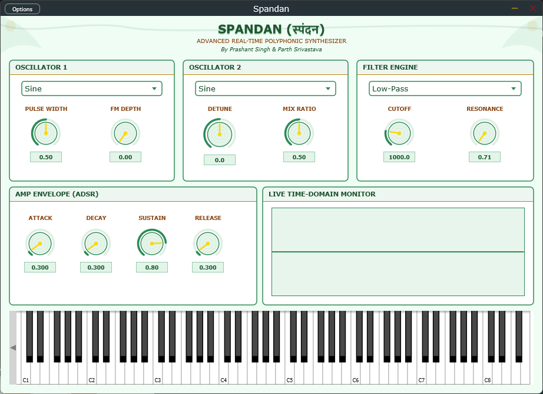

# 🎹 SPANDAN (स्पंदन)

**An Advanced Real-Time Polyphonic Software Synthesizer (VST3 / AU / Standalone)**

SPANDAN is a deterministic, polyphonic software synthesizer and audio DSP engine built from scratch in modern **C++ (C++20)** using the **JUCE 9** framework.

Developed as an undergraduate major project, SPANDAN is designed to demonstrate low-level audio signal processing, continuous-time analog filter modeling, and lock-free thread concurrency within strict real-time audio environments.



---

## ✨ Key Features & DSP Architecture

SPANDAN isn't just a sample player; all audio is mathematically generated and processed in real-time within the OS audio callback (`processBlock`), guaranteeing zero heap allocations and zero blocking synchronization.

### 🎛️ Oscillators & Sound Generation

* **Phase-Modulated NCO:** Employs a Numerically Controlled Oscillator with modulo-free normalized phase accumulators.
* **Classic Waveforms:** Band-limited Sine, Sawtooth, Square, Triangle, variable duty cycle Pulse, and PRNG White Noise.
* **Audio-Rate Modulation:** Built-in FM/PM capabilities based on John Chowning’s principles to generate rich, dynamic harmonic overtones.

### 🎚️ Analog-Modeled Filters

* **Zero-Delay Feedback (ZDF):** Implements Vadim Zavalishin's Topology-Preserving Transform (TPT) 2-pole State Variable Filter.
* **No Warping:** Uses exact frequency pre-warping to prevent BZT frequency distortion near the Nyquist limit.
* **Modes:** Smooth morphing across Lowpass (LP), Highpass (HP), and Bandpass (BP) modes.

### 📉 Envelopes & Polyphony

* **Snappy ADSR:** Uses a recursive IIR filter (Moog-Ussachevsky RC network model) with a 150% attack target overshoot for incredibly punchy, analog-style transients.
* **16-Voice Polyphony:** Custom voice stealing algorithm prioritizing oldest timestamps, combined with a 5ms linear fade-out to prevent digital clicks.
* **Headroom Scaling:** Automatic equal-power scaling to prevent digital bus clipping (`0 dBFS`) when playing large chords.

### 🖥️ UI & Concurrency

* **Lock-Free Architecture:** Decouples the UI thread from the DSP thread using a Single-Producer Single-Consumer (SPSC) Ring Buffer with `std::atomic` and memory barrier semantics.
* **Live Oscilloscope & Spectrum:** Real-time 2048-point Radix-2 FFT spectral analyzer (with Hann windowing) and a zero-crossing stabilized time-domain oscilloscope.
* **Cyber-Jungle UI:** Fully custom vector rendering and color palette built extending `juce::LookAndFeel`.

---

## 🚀 Installation & Usage

**For Musicians / Producers:**

1. Download the latest compiled binaries for your OS from the [Releases Tab](https://www.google.com/search?q=https://github.com/cryparc/Spandan/releases).
2. **Mac:** Place `.component` in `/Library/Audio/Plug-Ins/Components` and `.vst3` in `/Library/Audio/Plug-Ins/VST3`.
3. **Windows:** Place `.vst3` in `C:\Program Files\Common Files\VST3`.
4. Rescan plugins in your DAW (Logic Pro, FL Studio, Ableton, etc.) and load SPANDAN!

**For Developers (Build from Source):**
SPANDAN requires a C++20 compiler and **JUCE 9**.

```bash
# 1. Clone the repo
git clone https://github.com/cryparc/Spandan.git
cd Spandan

# 2. Open the project in Projucer
# -> Open Spandan.jucer

# 3. Export to your IDE (Xcode / Visual Studio)
# 4. Build the target in Release mode (to enable SIMD & DSP optimizations)

```

## 🎓 Academic Context

SPANDAN is developed as a final-year B.Tech Major Project at Ajay Kumar Garg Engineering College (AKGEC).

* **Developers:** Prashant Singh & Parth Srivastava
* **Project Guide:** Dr. Jitender Chhabra

📝 **Deep Dive:** For a complete mathematical breakdown of the algorithms used in SPANDAN, read the companion documentation: **[SPANDAN Engineering Cookbook](https://cryparc.github.io/Spandan/)**.

---
